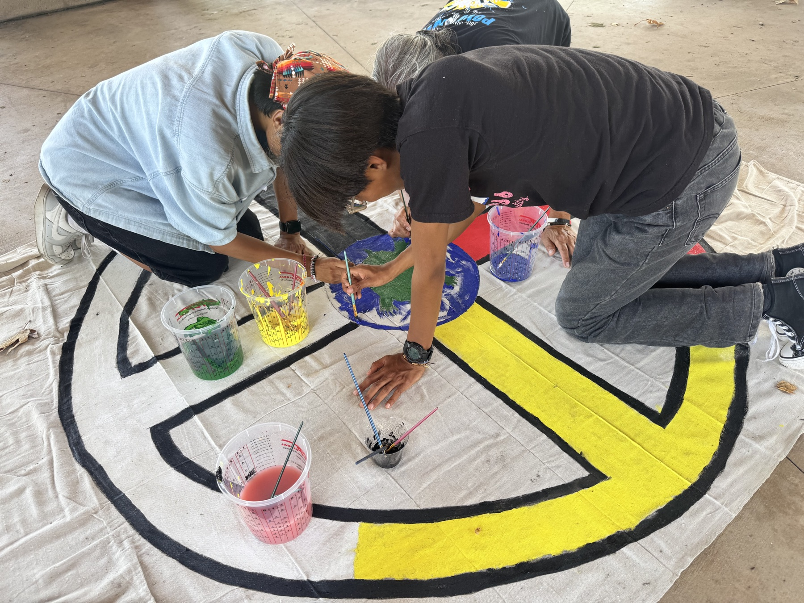
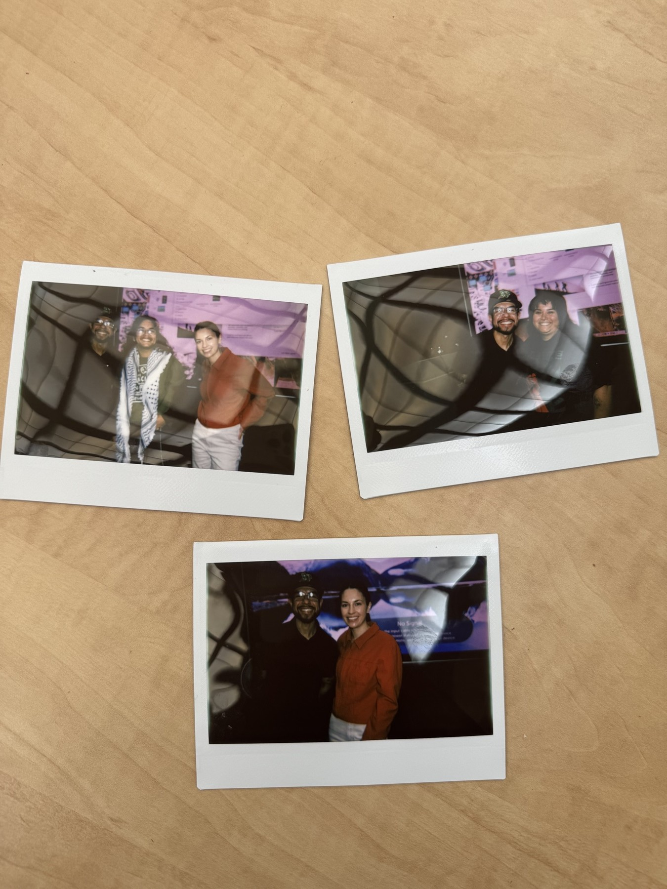
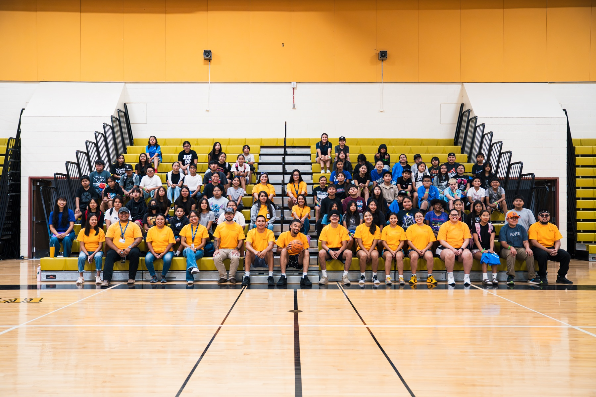
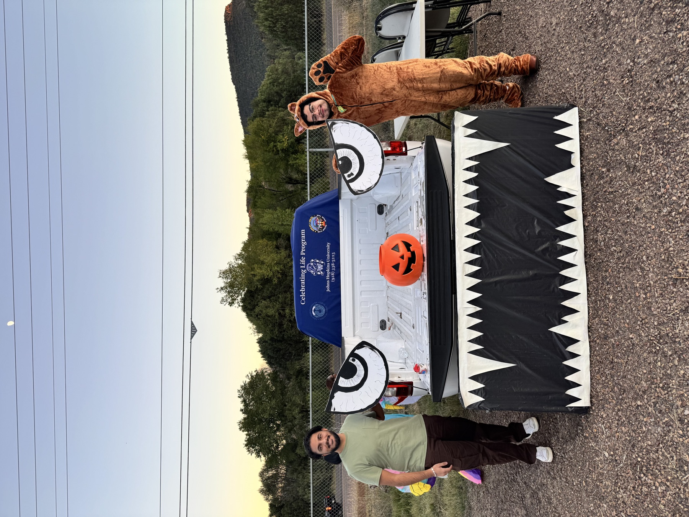
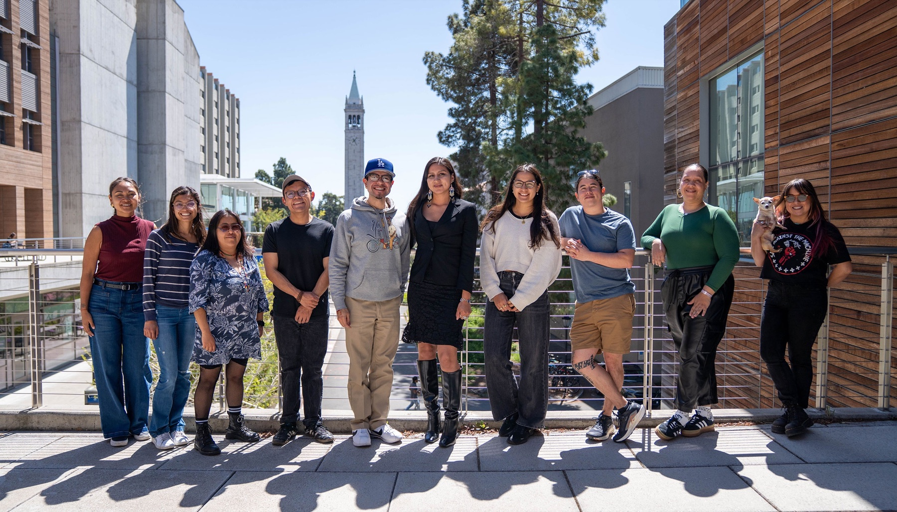
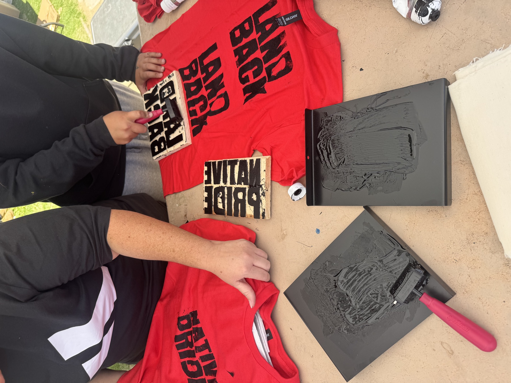
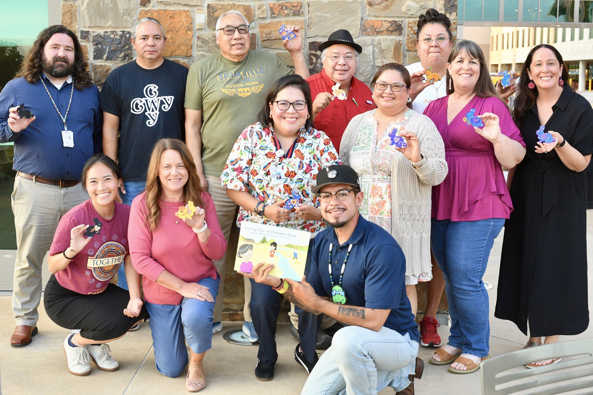
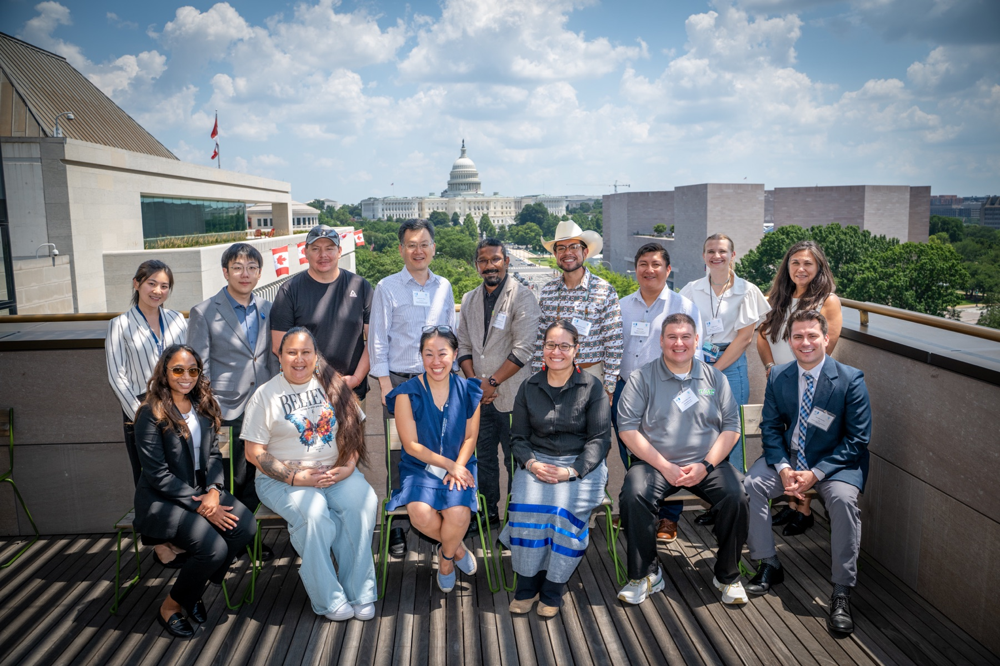

Photos from the field.

```{=html}
<section class="field-carousel" aria-label="Community and field research photos" aria-roledescription="carousel" tabindex="0">
  <div class="field-slide" role="group" aria-roledescription="slide" aria-label="1 of 8">
    <figure>
      
      <figcaption>Youth painting a Medicine Wheel mural at an IndigiText Project–sponsored Gathering of Native Americans event, San Diego, CA, July 2026.</figcaption>
    </figure>
  </div>
  <div class="field-slide" role="group" aria-roledescription="slide" aria-label="2 of 8">
    <figure>
      
      <figcaption>Celebrating the Teaching Effectiveness Award with SW114: Practice in Social Work students, UC Berkeley, April 2024.</figcaption>
    </figure>
  </div>
  <div class="field-slide" role="group" aria-roledescription="slide" aria-label="3 of 8">
    <figure>
      
      <figcaption>Participants at the NativeVision Camp, Chinle, Navajo Nation, July 2025.</figcaption>
    </figure>
  </div>
  <div class="field-slide" role="group" aria-roledescription="slide" aria-label="4 of 8">
    <figure>
      
      <figcaption>Community outreach at the White Mountain Apache Tribe’s Trunk or Treat event, October 2025.</figcaption>
    </figure>
  </div>
  <div class="field-slide" role="group" aria-roledescription="slide" aria-label="5 of 8">
    <figure>
      
      <figcaption>Native FEWS Alliance gathering with Selina Martinez (Pascua Yaqui), UC Berkeley, June 2023.</figcaption>
    </figure>
  </div>
  <div class="field-slide" role="group" aria-roledescription="slide" aria-label="6 of 8">
    <figure>
      
      <figcaption>Youth screen-printing T-shirts at an IndigiText Project–sponsored Gathering of Native Americans event, San Diego, CA, July 2026.</figcaption>
    </figure>
  </div>
  <div class="field-slide" role="group" aria-roledescription="slide" aria-label="7 of 8">
    <figure>
      
      <figcaption>Cherokee Nation Storybook Project Community Advisory Board celebrating the first printing of <em>Visiting Elisi</em>, Tahlequah, OK, September 2026.</figcaption>
    </figure>
  </div>
  <div class="field-slide" role="group" aria-roledescription="slide" aria-label="8 of 8">
    <figure>
      
      <figcaption>Participants at the AIM-AHEAD and AIHEC Data Science Training Institute, Washington, DC, July 2025.</figcaption>
    </figure>
  </div>
  <div class="field-controls" hidden>
    <button type="button" class="field-previous" aria-label="Previous photo">← Previous</button>
    <span class="field-status" role="status" aria-live="polite" aria-atomic="true">1 / 8</span>
    <button type="button" class="field-next" aria-label="Next photo">Next →</button>
  </div>
</section>
<script>
(() => {
  const carousel = document.querySelector('.field-carousel');
  const slides = Array.from(carousel.querySelectorAll('.field-slide'));
  let current = 0;
  const show = (index) => {
    current = (index + slides.length) % slides.length;
    slides.forEach((slide, i) => { slide.hidden = i !== current; });
    carousel.querySelector('.field-status').textContent = `${current + 1} / ${slides.length}`;
  };
  show(0);
  carousel.querySelector('.field-controls').hidden = false;
  carousel.querySelector('.field-previous').addEventListener('click', () => show(current - 1));
  carousel.querySelector('.field-next').addEventListener('click', () => show(current + 1));
  carousel.addEventListener('keydown', (event) => {
    if (event.key === 'ArrowLeft' || event.key === 'ArrowRight') {
      event.preventDefault();
      show(current + (event.key === 'ArrowLeft' ? -1 : 1));
    }
  });
})();
</script>
```
